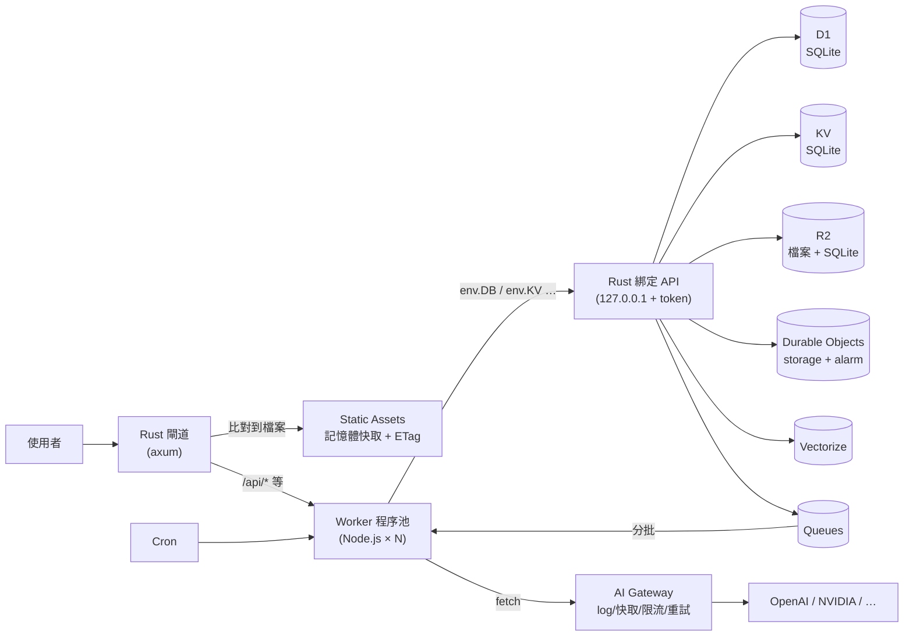

# rucloud

**A self-hostable Cloudflare-Workers-like platform.** The Rust core handles the edge gateway, static assets and every data binding (D1 / KV / R2 / Queues / Cron / Durable Objects / Vectorize / Rate Limiting / AI Gateway). Worker JavaScript runs unmodified on Node.js. Point it at a folder with a `wrangler.jsonc` and it runs.

自架的 Cloudflare Workers 平台：**Rust 寫基礎建設、Node.js 跑 Worker 程式碼**。拿現成的 wrangler 專案（`wrangler.jsonc` 或 `wrangler.toml`、JS 或 TypeScript、`public/`），不改一行就能在自己的機器或 Docker 上跑。

```bash
cargo install rucloud
rucloud dev path/to/my-worker --d1-init DB=schema.sql     # 像 wrangler dev
rucloud serve rucloud.toml                                  # 一個程序跑多個應用
docker compose up --build                                   # 用 Docker 跑 test-apps
```

需要 Node.js 22.15 以上（建議 24）。

## 架構



* 靜態檔案完全不經過 JS：Rust 直接回應（約 9.6 萬 req/s）。
* Worker 程式碼用 Node 跑，`fetch`、`Request`、`Response`、`ReadableStream`、`crypto.subtle` 都是原生的；串流（SSE）一路穿透。
* 所有狀態都在 Rust 這邊（SQLite），所以 Worker 程序可以開很多個、掛了自動重開，資料一致。
* Worker 程序跑在 Node 權限模型的沙箱裡（只能讀自己的資料夾、不能開子程序），每個應用有自己的綁定 token；卡住或記憶體爆掉會自動重開。
* Durable Object 依 id 固定交給同一個程序，保證單一實例；同一物件的事件依序處理。

詳細設計見 [doc/architecture.md](doc/architecture.md)。

## 支援的 Cloudflare 產品

| 產品 | wrangler 設定 | 狀態 |
|---|---|---|
| Workers（`export default { fetch }`、`WorkerEntrypoint`、`addEventListener`） | `main` | ✓ |
| WebSocket（`WebSocketPair`、101 回應） | — | ✓ |
| Static Assets（`run_worker_first`、`not_found_handling`、`env.ASSETS.fetch`） | `assets` | ✓ |
| 環境變數 / 密鑰（`.dev.vars`、`.env`、`env_file`） | `vars` | ✓ |
| D1（`prepare/bind/first/all/run/raw`、`batch` 交易、`exec`） | `d1_databases` | ✓ |
| KV（`get/put/delete/list`、metadata、TTL、bulk get） | `kv_namespaces` | ✓ 強一致 |
| R2（`get/put/head/delete/list`、range、metadata、delimiter、multipart） | `r2_buckets` | ✓ |
| R2 的 S3 相容 API（SigV4、presigned URL、multipart） | `rucloud.toml` 的 `[s3]` | ✓ |
| Queues（producer + consumer、批次、retry、delay、DLQ，跨應用） | `queues` | ✓ |
| Cron Triggers | `triggers.crons` | ✓（開發模式可 `GET /__scheduled?cron=...`） |
| Durable Objects（`fetch`、RPC 方法、`ctx.storage`、`blockConcurrencyWhile`、alarm、WebSocket hibernation、`ctx.storage.sql`） | `durable_objects`、`migrations` | ✓ |
| Vectorize（`upsert/insert/query/getByIds/deleteByIds`、metadata 過濾） | `vectorize` | ✓ 暴力搜尋 |
| Rate Limiting binding | `ratelimits` | ✓ |
| Service bindings（`env.OTHER.fetch`） | `services` | ✓ |
| Workers AI（`env.AI.run`） | `ai` | ✓ 轉給 OpenAI 相容後端 |
| AI Gateway（log、快取、限流、重試） | `rucloud.toml` 的 `[ai_gateway]` | ✓ |
| `import … from 'cloudflare:workers'`、`caches.default` | — | ✓ |

完整的 API 對照與差異見 [doc/bindings.md](doc/bindings.md)。

## 指令

| 指令 | 用途 |
|---|---|
| `rucloud dev [應用資料夾] --port 8787 [--env 名稱] [--instances N] [--d1-migrate] [--d1-init DB=schema.sql] [--state .rucloud]` | 開發模式，程式碼改了自動重載 |
| `rucloud serve [rucloud.toml]` | 依設定檔同時跑多個應用（正式部署） |
| `rucloud d1 execute <應用資料夾> <資料庫> --file schema.sql \| --command "SELECT …"` | 對本機 D1 執行 SQL |
| `rucloud d1 migrations create \| list \| apply <應用資料夾> <資料庫>` | D1 migrations（同 wrangler 的格式） |
| `rucloud kv put \| get \| list \| delete <應用資料夾> … --binding KV` | 本機 KV |
| `rucloud r2 object put \| get \| list \| delete <應用資料夾> <bucket>/<key>` | 本機 R2 |
| `rucloud ai-gateway --port 8790 [--cache-ttl 60]` | 單獨跑 AI Gateway |

`rucloud.toml` 的寫法與 Docker 部署見 [doc/deploy.md](doc/deploy.md)。

## 跑 test-apps

`cloudflare/test-apps`（和本 repo 放在同一層的資料夾）裡的四個應用都能直接跑（已驗證）：

| 應用 | 用到 | 指令 |
|---|---|---|
| mini-lang-expert | Workers、Assets、密鑰、外連 SSE 串流 | `rucloud dev ../cloudflare/test-apps/mini-lang-expert` |
| aichat | Workers、Assets、串流代理 | `rucloud dev ../cloudflare/test-apps/aichat` |
| myshop | D1、HMAC cookie、PBKDF2 | `rucloud dev ../cloudflare/test-apps/myshop --d1-init DB=schema.sql` |
| friendbook | D1 + KV | `rucloud dev ../cloudflare/test-apps/friendbook --d1-init DB=schema.sql` |

或一次全部跑起來：`docker compose up --build`，再開 <http://localhost:8701>～<http://localhost:8704>。

## 範例

| 範例 | 內容 | `rucloud serve examples/rucloud.toml` 後的網址 |
|---|---|---|
| [examples/showcase](examples/showcase) | 所有綁定一次示範（R2、Queues、Cron、DO、Vectorize、限流、service binding） | <http://localhost:8710> |
| [examples/hello](examples/hello) | 最小 Worker，給 showcase 的 service binding 呼叫 | <http://hello.localhost:8700> |
| [examples/chat](examples/chat) | WebSocket 聊天室：每個房間一個 SQLite 型 Durable Object（hibernation API + `ctx.storage.sql`） | <http://localhost:8713> |
| [examples/myshop](examples/myshop) | 個人商店 POS：D1、HMAC cookie、PBKDF2（取自 test-apps） | <http://localhost:8711> |
| [examples/friendbook](examples/friendbook) | 社群網站：D1 + KV 快取與熱門排行（取自 test-apps） | <http://localhost:8712> |

```bash
rucloud serve examples/rucloud.toml
curl localhost:8710/api/do        # Durable Object 計數器
```

myshop 與 friendbook 示範用的 `AUTH_SECRET` 放在 `.dev.vars.example`，自己部署時請換掉。

## 授權

MIT
