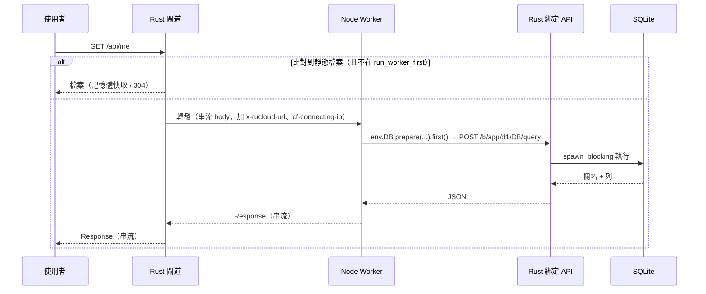
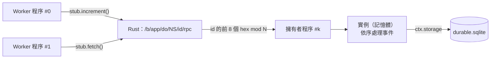

# 架構

rucloud 把 Cloudflare Workers 平台拆成兩半：

* **Rust（rucloud 執行檔）**：所有「基礎建設」——HTTP 閘道、靜態檔案、資料儲存、排程、佇列、程序監管。
* **Node.js（Worker 程序）**：只跑使用者的 Worker 程式碼。`env` 裡的每個綁定都是呼叫 Rust 的薄包裝。

## 1. 元件

| 檔案 | 職責 |
|---|---|
| `src/main.rs` | CLI：`dev`、`serve`、`d1 execute`、`ai-gateway` |
| `src/config.rs` | 解析 `wrangler.jsonc`（JSONC）、`.dev.vars`、`rucloud.toml` |
| `src/server.rs` | 啟動所有元件；cron、DO 鬧鐘、KV 過期清理、檔案變動重載 |
| `src/gateway.rs` | 邊緣閘道：靜態檔案優先、轉發到 Worker、Host 分派 |
| `src/assets.rs` | Static Assets：路徑比對、`run_worker_first`、SPA / 404、記憶體快取、ETag |
| `src/pool.rs` | Worker 程序池：啟動、`RUCLOUD_READY` 握手、輪流分派、崩潰重開 |
| `src/bindings.rs` | 綁定 API（`127.0.0.1`，token 驗證） |
| `src/d1.rs` `kv.rs` `r2.rs` `durable.rs` `vectorize.rs` `queues.rs` | 各產品的儲存（SQLite + 檔案） |
| `src/ai.rs` / `src/ai_gateway.rs` | Workers AI 綁定 / AI Gateway |
| `runtime/host.mjs` | Node 端：載入 Worker、建 `env`、HTTP 伺服器、DO 實例、queue/scheduled 事件 |
| `runtime/cloudflare-workers.mjs` | `import … from 'cloudflare:workers'` 的實作 |

兩個 JS 檔用 `include_str!` 編進執行檔，啟動時寫到 `<state>/runtime/`，所以發佈只需要一個執行檔加上 Node。

## 2. 一個請求的路徑



* 閘道把外來請求裡的 `x-rucloud-*` 標頭全部拿掉，`/__rucloud*` 路徑一律 404，外部無法偽造內部事件。
* 綁定 API 只聽 `127.0.0.1` 的隨機埠，每次啟動產生新的 token。

## 3. 為什麼這樣分

| 選擇 | 理由 |
|---|---|
| Worker 程式碼用 Node，不自己嵌 V8 | 相容性最好（`fetch`、Web Streams、WebCrypto 都是原生的），也能用 npm 套件；編譯快、映像小 |
| 狀態全放 Rust | Worker 程序可以隨時重開、開多個；SQLite 的存取集中在一處，不會有多程序同時寫檔的問題 |
| 靜態檔案在 Rust | 前端檔案是流量大宗，完全不進 JS |
| 程序間用 HTTP（loopback + keep-alive） | 簡單、可串流（R2 上傳下載、DO fetch 都不經過記憶體緩衝） |

## 4. Durable Objects 的單一實例



* `idFromName(name)` 是 `sha256(app:binding:name)`，任何程序算出來都一樣。
* 擁有者程序裡，同一個物件的事件用 promise 鏈依序執行（近似 Cloudflare 的 input gate），所以讀-改-寫不會被插隊；實測 3 個程序、50 個並行請求，計數器結果完全正確。
* `ctx.storage` 在擁有者程序裡有記憶體快取（寫入直達 SQLite）。

## 5. 佇列與排程

* Queues 是全域的（`<state>/queues.sqlite`）：A 應用送、B 應用收都可以。
* 消費者依 `max_batch_size`、`max_batch_timeout` 分批；`message.retry()` 或 handler 丟例外會重送，超過 `max_retries` 移到 `dead_letter_queue` 或丟棄。取出的訊息有 5 分鐘租約，程序當掉也不會遺失。
* Cron 用 UTC，5 個欄位（同 Cloudflare）。

## 6. 資料存放

```
<state>/
  runtime/host.mjs, cloudflare-workers.mjs
  queues.sqlite                 全域佇列
  ai-gateway.sqlite             AI Gateway 的 log 與快取
  <應用名稱>/
    d1/<database_name>.sqlite   D1
    kv.sqlite                   KV（所有 namespace）
    r2/r2.sqlite, r2/objects/   R2
    durable.sqlite              DO storage（KV 型）+ alarm
    do-sqlite/<binding>/<id>.sqlite   SQLite 型 DO，每個物件一個檔
    vectorize.sqlite            Vectorize
```

都是一般的 SQLite 檔，可以直接用 `sqlite3` 打開、備份。
