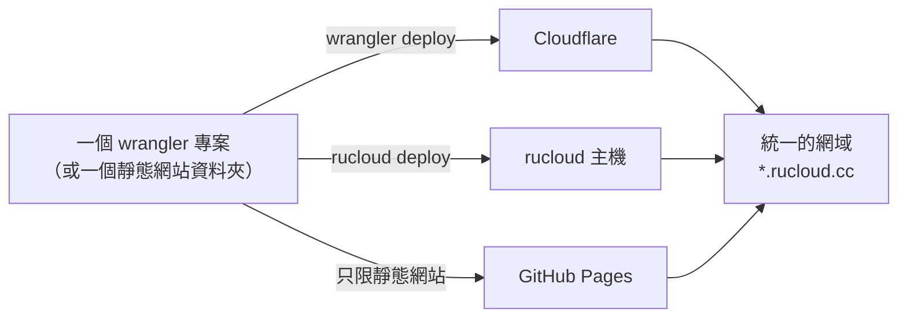

# 發展路線

一版補一塊和 Cloudflare 的差距，依「對實際應用的影響」排序。每版都會更新 [CHANGELOG.md](../CHANGELOG.md) 與 [bindings.md](bindings.md)。這份規劃會隨做隨調。

| 版本 | 主題 | 內容 | 狀態 |
|---|---|---|---|
| 0.1.x | 基礎 | 閘道、Assets、D1/KV/R2/Queues/Cron/DO/Vectorize/限流/service/AI、AI Gateway、Docker | ✓ |
| 0.2.0 | WebSocket | 閘道轉發 upgrade；Worker 的 `WebSocketPair`、`new Response(null, {status: 101, webSocket})`；Durable Object 的 `ctx.acceptWebSocket` 與 hibernation handler（`webSocketMessage/Close/Error`）、`getWebSockets`、tags | ✓ |
| 0.3.0 | DO SQL storage | `ctx.storage.sql.exec()`（同步，Node 內建 `node:sqlite`），`migrations[].new_sqlite_classes`；SQLite 型 DO 的 KV API 也存在同一個資料庫 | ✓ |
| 0.4.0 | R2 進階 | S3 相容 API（SigV4 驗證：List/Get/Put/Head/Delete/Copy、multipart）；binding 的 `createMultipartUpload` | ✓ |
| 0.5.0 | 沙箱 | Node 權限模型（只能讀應用資料夾、不能開子程序）、記憶體上限、請求逾時、乾淨的 `process.env` | ✓ |
| 0.6.0 | wrangler 相容 | `wrangler.toml`、`--env` 多環境、模組規則（`import` 文字 / 資料 / wasm）、`rucloud kv` / `rucloud r2` 指令 | ✓ |
| 0.7.0 | HTMLRewriter | `HTMLRewriter` 子集（選擇器、element/text/comments/document handler） | ✓ |

## 還缺什麼（0.7.0 時的盤點）

| 面向 | 缺口 | 影響 |
|---|---|---|
| **品質** | 沒有放進 repo 的整合測試：每版都是手動跑腳本驗證；沒有 CI | 改動容易壞掉舊功能而沒發現 |
| **維運** | 只處理 Ctrl-C，沒有處理 SIGTERM，也沒有等進行中的請求做完（`docker stop` 會直接砍掉）；沒有 metrics；log 只印在 stdout，沒有 `tail` | 正式環境難以監控與排錯 |
| **部署** | 沒有部署 API、版本紀錄、rollback；改 `wrangler.jsonc` 要整個重啟 | 每次更新都要登入主機 |
| **網路** | 沒有內建 HTTPS（要自己架反向代理）；Worker 回應不會被快取；靜態檔案沒有壓縮 | 小型部署還要多架一層 |
| **資源** | Durable Object 永遠留在記憶體、SQLite 連線不關；沒有備份指令 | 物件多了以後記憶體一直長 |
| **執行環境** | Workflows、service binding 的 RPC 與具名 entrypoint、`connect()`、Worker 主動連出的 WebSocket、串流 HTMLRewriter | 部分 Cloudflare 專案跑不起來 |
| **資料** | Hyperdrive、Analytics Engine、R2 事件通知（→ Queues）、D1 匯出 / 匯入、Queues 的 HTTP pull | 進階應用缺功能 |
| **AI** | Workers AI 不支援串流與圖片 / 語音模型；Vectorize 是暴力搜尋；AI Gateway 沒有 fallback 鏈與儀表板 | 大規模 RAG 不適合 |
| **規模** | 單機：所有狀態在一台機器的 SQLite | 無法水平擴充、沒有高可用 |

## 接下來的版本

依「先穩、再好維運、再補功能」排序。每版的內容做的時候可能再調整。

| 版本 | 主題 | 內容 |
|---|---|---|
| 0.8.0 ✓ | 測試與 CI | `tests/` 整合測試（`cargo test` 起 rucloud、跑 examples 與各綁定、WebSocket、S3、沙箱）；GitHub Actions（fmt、clippy、test、Docker build） |
| 0.9.0 ✓ | 維運 | SIGTERM 優雅關閉（停止收新請求、等進行中的請求、關掉 Worker 程序）；`/__rucloud/metrics`（Prometheus：請求數、延遲、Worker 重啟、綁定呼叫）；log 存檔與 `rucloud tail <應用>`；健康檢查端點 |
| 0.10.0 ✓ | 部署 | 管理 API（token 驗證）：上傳新版本（tar）、版本列表、rollback、熱重載設定；`rucloud deploy` 指令；Durable Object 閒置逐出；`rucloud backup` / `restore`（SQLite 線上備份） |
| 0.11.0 ✓ | 邊緣 | HTTPS（自備憑證 / ACME）、HTTP 轉址；閘道快取（選擇性開啟，Cloudflare 本身不會自動快取 Worker 回應）、`caches.default` 跨程序共用；gzip / brotli |
| 0.12.0 ✓ | 執行環境 | Workflows（`step.do` / `step.sleep` / `step.waitForEvent`，進度存 SQLite，可重試、可恢復）；service binding RPC 與具名 entrypoint；Worker 主動連出的 WebSocket（`fetch` + `Upgrade`） |
| 0.13.0 ✓ | 資料 | Hyperdrive（`connectionString` 與連線參數）；Analytics Engine（`writeDataPoint` 存 SQLite，提供 SQL 查詢 API）；R2 事件通知送進 Queues；`rucloud d1 export / import`；Queues 的 HTTP pull consumer |
| 0.14.0 ✓ | 串流與 socket | 串流 HTMLRewriter（邊讀邊改）；`connect()` TCP socket（`cloudflare:sockets`） |
| 0.15.0 ✓ | AI | Workers AI 串流（SSE）；AI Gateway 的 Universal endpoint（fallback）；Vectorize 精確搜尋改成多執行緒 + heap（約 4 倍快）。HNSW 等近似索引延後：精確搜尋在 10 萬筆內已經夠快，近似索引會讓結果不再精確 |
| 1.0.0 ✓ | 穩定 | 設定檔嚴格檢查、`rucloud check`、資料夾格式版本、相容性承諾（doc/stability.md） |

## 1.x

1.0 之後只加功能、不破壞相容性（見 [stability.md](stability.md)）。

| 版本 | 主題 | 內容 | 狀態 |
|---|---|---|---|
| 1.1.0 ✓ | 管理介面 | 管理埠上的網頁：應用狀態、即時 log、版本與 rollback、快取清除、Analytics 查詢、佇列 | |
| 1.2.0 ✓ | 開發體驗 | `rucloud init`（4 個範本）、`rucloud types`（產生 `Env` 型別）、`--enable-source-maps`（TypeScript 的行號本來就正確） |
| 1.3.0 ✓ | 持續複寫 | SQLite 的變更持續送到 S3 / R2（類似 Litestream），機器壞了可以在另一台還原到幾秒前 | |
| 1.4.0 ✓ | workerd 評估、執行中新增應用 | workerd 已評估，結論見 [workerd.md](workerd.md)：沒有 CPU 限制、也不是 hardened sandbox，暫不做成執行環境。另外加入 `[dynamic]`：透過管理 API 在執行中新增應用，每個應用自己的程序、沙箱、資料與網域 |

## 自架成像 Cloudflare 一樣（1.5～1.7）

| 版本 | 主題 | 內容 |
|---|---|---|
| 1.5.0 ✓ | 自己的網域與自動憑證 | `[domain]` 自動子網域、wrangler `routes`、每個網域一張憑證與 on-demand、`trusted_proxies` |
| 1.6.0 ✓ | 像 `wrangler deploy` 一樣部署 | 部署時自動新增應用、`rucloud secret`、管理 API 透過 HTTPS 對外 |
| 1.7.0 ✓ | 新主機幾分鐘架好 | 萬用字元憑證（DNS-01：Cloudflare、Linode）、預編執行檔、安裝腳本與 systemd |
| 1.8.0 ✓ | 安裝不可信的應用 | `[install]`（權限、props、對外連線）、Queues 與 Workflows 各自一份、Images、寄信（SMTP）、Workers AI 的設定與用量、Unix socket、`[isolation]`（bubblewrap、出口代理、cgroup、seccomp）；為 ruwebos 做的 |

## 定位：同一個專案，Cloudflare 與自己的主機都能跑（1.9～2.0）

rucloud 是用來架設**應用與個人網站**的平台，而且和 Cloudflare 相容：同一個 wrangler 專案，不改程式碼，既能 `wrangler deploy` 到 Cloudflare，也能 `rucloud deploy` 到有 rucloud 的主機。純靜態的網站也可以放在 GitHub Pages。

所以接下來的重點是：

* **相容性要能被驗證**，不只是我們自己說相容。
* **資料也要能帶走**，不只程式碼能搬。
* **小主機也能放很多應用**，自己架才划算。

| 版本 | 主題 | 內容 |
|---|---|---|
| 1.9.0 | 相容性看得見 | `rucloud check --cloudflare`；範例標示能在哪裡跑；CI 驗證 wrangler 讀得懂每個範例；`doc/cloudflare.md`；靜態網站的三種放法 |
| 1.10.0 | 兩邊互相搬家 | D1 / KV / R2 的匯出與匯入；GitHub Actions 部署範本；`rucloud deploy --from github:…` |
| 2.0.0 | 小主機放很多應用 | 閒置的應用停止 Worker 程序（scale to zero）；個人網站範本 |

### 1.9.0 — 相容性看得見

* **`rucloud check --cloudflare`**：檢查專案搬到 Cloudflare 會不會壞，例如用了只有 rucloud 才有的東西（`[dynamic]`、`rucloud.toml` 才有的設定、Cloudflare 不支援的 Node API），或可能超過 Cloudflare 免費方案的限制（例如很長的串流、大量 CPU）。反過來，也列出 Cloudflare 有、但 rucloud 不支援的綁定。
* **範例標示能在哪裡跑**：每個範例都標「Cloudflare ✓ / rucloud ✓」。只能在 rucloud 跑的範例（例如 app-builder 用了 `[dynamic]` 和長時間的 AI 串流）要清楚標出來。
* **CI 驗證**：每個範例都用 `wrangler deploy --dry-run` 驗證 wrangler 讀得懂。實際部署到 Cloudflare 需要帳號與 token，之後再加。
* **`doc/cloudflare.md`**：一張表列出每種綁定在兩邊的支援狀況與差異。
* **靜態網站的三種放法**（文件）：GitHub Pages、Cloudflare、rucloud 主機，以及各自的 DNS 設定。放在 GitHub Pages 的網站用 CNAME 掛在自己的網域下，流量直接走 GitHub、不經過主機；rucloud 只替屬於應用的網域申請憑證，所以不會跟它衝突。
* **portal 改成統一的作品清單**：同時列出主機上的應用、放在 GitHub Pages 與 Cloudflare 的網站，每張卡片標示放在哪裡、能在哪裡跑，並附原始碼連結。

### 1.10.0 — 兩邊互相搬家

* **D1**：`rucloud d1 export` / `import`，格式和 `wrangler d1 export` 相同（SQL 檔），可以在 Cloudflare 與 rucloud 之間互搬。
* **KV、R2**：匯出與匯入。R2 已經有 S3 相容 API，先寫文件說明怎麼用 rclone 搬。
* **密鑰**：`rucloud secret` 與 `wrangler secret` 的對照寫進文件。
* **GitHub Actions 部署範本**：push 之後部署到 GitHub Pages、Cloudflare、rucloud 主機其中一個或多個，原始碼只有一份，改一行設定就能換地方。
* **`rucloud deploy --from github:擁有者/repo --path 子資料夾`**：直接從 GitHub 拿檔案部署，不必先 clone。

### 2.0.0 — 小主機放很多應用

* **閒置的應用停止 Worker 程序（scale to zero）**：一段時間沒有請求就停掉，有請求時再啟動，和 Cloudflare 一樣「有請求才執行」。1 GB 的小主機也能放幾十個個人網站與應用；也解決 `[dynamic]` 每個應用多一個 Node 程序、可能吃光記憶體的問題。需要處理冷啟動時間、Durable Object 的狀態、Cron 與佇列（停掉的應用也要能被喚醒）。
* **純靜態的個人網站不啟動 Node**（已經是這樣：只有 assets 的應用由 Rust 直接回應），在文件中強調這是架個人網站的主要用法。
* **`rucloud init -t site`**：個人網站範本，Cloudflare、rucloud、GitHub Pages 都能部署。

### 不建議的做法

* **讓 rucloud 代理放在 GitHub Pages 的網站**：每個請求都會經過自己的主機，白白消耗流量。用 DNS 的 CNAME 直接指過去就好。
* **把 GitHub Pages 的網站複製一份到主機上**：會變成兩份要同步；要搬家時才複製。

### 範例主機（rucloud.cc）的維運

不是 rucloud 的版本，但和上面的定位一起做：

* 關掉各應用直接對外的 HTTP 埠號（8710～8718），只透過 `https://<應用>.rucloud.cc/` 連線。
* 在 scale to zero 之前，先限制 `[dynamic] max_apps`（例如 5），避免 app-builder 產生的專案吃光 1 GB 的記憶體。
* 開啟 `[replicate]`，把資料持續備份到 Cloudflare R2：主機上的資料也備份到 Cloudflare。
* 補上 favicon、Open Graph 預覽，以及各範例「← 所有範例」的回首頁連結。

## 之後再考慮

* **多台機器**：多台共用狀態、Durable Object 的跨機器路由。
* **Containers**：Cloudflare Containers 的對應（rucloud 本來就在 Docker 裡，可以由 Worker 啟動容器）。
* **Browser Rendering**：接本機的 Chromium（Puppeteer / Playwright 相容介面）。

## 不打算做的

全球複製與 Anycast、Cloudflare 的 DDoS / WAF 網路、Email Routing 等依賴 Cloudflare 自家網路的產品。
