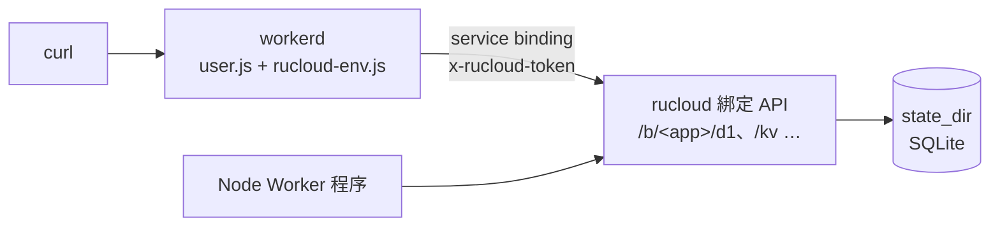

# workerd 評估（1.4.0）

目標：評估用 Cloudflare 開源的 [workerd](https://github.com/cloudflare/workerd) 取代 Node 跑 Worker，看能不能得到**真正的 isolate 隔離**與 **CPU 限制**；可行就做成可選的執行環境。

**結論：技術上可行，但這兩個主要動機在獨立版 workerd 都得不到，所以目前不做成執行環境。** Node 仍是唯一的執行環境。

## 做了什麼

用 npm 的 `workerd@1.20261104.1`（Apache-2.0）在 macOS arm64 上做概念驗證：

* 一小段 `rucloud-env.js` 把 rucloud 既有的綁定 HTTP API 包成 `env.DB`（`prepare/bind/all/first/run/exec`）和 `env.KV`（`get/put`）。
* workerd 用 `external` service 連到 rucloud 的綁定 API，`vars` 直接用 workerd 原生的 `text` 綁定。
* `globalOutbound` 指到 `network = (allow = ["public"], deny = ["local"])`。

## 結果

| 項目 | 結果 |
|---|---|
| 跑 Worker、讀寫 D1 / KV | ✓ 和 Node 那邊共用同一份資料（workerd 寫 2 筆，Node 接著看到第 3 筆） |
| 擋內網 / metadata 連線 | ✓ 連 `169.254.169.254` 被拒：`connecting to 169.254.169.254:80 is not allowed` |
| `node:fs` | workerd 的是虛擬檔案系統，碰不到主機檔案 |
| 啟動到可回應 | 約 290 ms |
| 常駐記憶體 | 約 30 MB（hello world） |
| **CPU 限制** | ✗ 設定 schema 裡沒有 CPU 時間或記憶體上限；3 秒的忙迴圈照樣跑完 |
| **隔離** | ✗ 上游 README 明說 workerd 不是 hardened sandbox，跑不可信的程式要再包一層 VM 之類的沙箱 |
| 執行檔大小 | 每個平台約 142 MB，不能嵌進 crate，要另外下載 |

## 為什麼不做

1. **CPU 限制拿不到。** Cloudflare 線上的 CPU 限制由它們內部的機制執行，開源的 workerd 沒有對應設定。rucloud 現在的做法（每個應用一個 Node 程序 + 逾時就重開程序）反而能處理無窮迴圈。
2. **隔離沒有比較好。** 多個 Worker 放進同一個 workerd 程序，彼此只靠 V8 isolate 分開；上游自己建議不要單靠它跑不可信程式。rucloud 現在是一個應用一個 OS 程序，加上 `--permission` 沙箱與對外連線限制，邊界其實更清楚。
3. **成本高。** `runtime/host.mjs` 約 1,700 行的綁定實作（D1、KV、R2、Durable Objects、佇列、Workflows、Vectorize、AI、HTMLRewriter、sockets…）都要改寫成 workerd 能跑、只透過 service binding 溝通的版本；Durable Objects 不能用 workerd 自己的儲存，否則資料不在 `state_dir`，備份與複寫都看不到。再加上 142 MB 的執行檔要跟著發佈。

## workerd 真正的好處

* **API 相容性**：它就是 Cloudflare 線上的執行環境，`compatibility_date`、`compatibility_flags`、Web API 的行為都一模一樣，不必靠 rucloud 自己補。
* 記憶體較少、啟動快。

## 之後什麼情況值得再做

* 使用者回報的相容性問題大多是「Node 和 Workers 行為不同」時，把 workerd 做成**可選**執行環境，給追求相容性而不是隔離的人用。
* 要跑不可信的程式時，正解是每個應用放進獨立的容器或 microVM（例如 Firecracker / gVisor），而不是換執行環境；這和用 Node 還是 workerd 無關。
