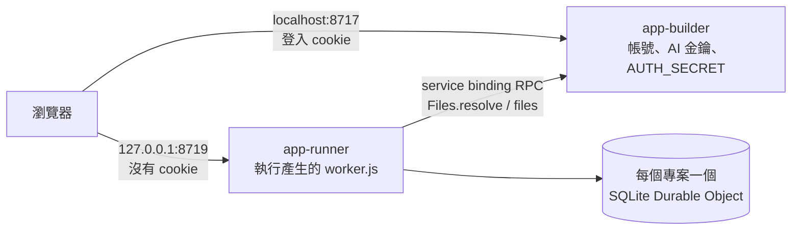

# app-builder — AI 網站產生器（Lovable 式）

輸入一句話，AI 幫你做出一個可部署在 rucloud / Cloudflare 上的靜態網站。具備帳號系統、AI 對話、版本管理；AI 金鑰由使用者自填（或用伺服器環境變數的測試金鑰）。

## 跑起來

```bash
cp examples/app-builder/.dev.vars.example examples/app-builder/.dev.vars   # 填入 AUTH_SECRET（與選填的 AI key）
rucloud serve examples/app-builder/rucloud.toml                            # http://localhost:8717
```

或跟其他範例一起跑：`rucloud serve examples/rucloud.toml`（<http://localhost:8717>）。

要兩個應用一起跑：**app-builder**（帳號、AI 對話，<http://localhost:8717>）與 **app-runner**（`runner/`，執行產生出來的 app，<http://127.0.0.1:8719>）。
`rucloud dev` 一次只跑一個資料夾，所以這個範例要用 `rucloud serve`。

> 注意：本範例**僅支援 rucloud**。Cloudflare Workers 免費方案每次呼叫只有 10ms CPU，
> 撐不起 AI 長串流的轉發（實測 `exceededCpu`），所以不部署到 Cloudflare。

## 功能

1. **註冊 / 登入** — email + 密碼（PBKDF2 雜湊、HMAC 簽章 cookie，同 myshop 的做法）
2. **兩種專案類型**
   - **靜態網頁**：單一 HTML 檔（內嵌 CSS/JS、localStorage），下載即用
   - **全端應用（Worker + D1）**：AI 產生完整的 rucloud / Cloudflare 專案——`src/worker.js`（D1 API）、`public/index.html`、`schema.sql`（`wrangler.jsonc` 由平台代產），下載 zip 後 `rucloud dev 資料夾 --d1-init DB=schema.sql` 直接跑
3. **AI 設定** — 選供應商（NVIDIA NIM / MiniMax / 自訂 OpenAI 相容端點）、模型、填 API Key（存在 D1，永遠不會回傳給前端）
   - 在 `.dev.vars` 或環境變數提供 `NVIDIA_API_KEY` / `MINIMAX_API_KEY`，就是全站預設金鑰，使用者不必填；沒有時使用者必須自填
4. **專案 + AI 對話** — 像 Lovable：一句話產生第一版；之後持續用對話修改。回應以 **SSE 串流**顯示（含思考過程），完成後自動存成新版本
5. **使用 app** — 右側即時預覽（iframe）、看程式碼（全端模式可切換檔案）、切換歷史版本；產生的 app 在 app-runner 的 `/apps/<專案id>/?v=<版本>`，公開可分享。全端專案是完整執行（後端 API + 專案專屬的 SQLite 資料庫）
6. **打包下載** — `⬇ 下載 zip`（或 `GET /api/projects/<id>/download?v=<版本>`）：靜態含 `index.html`；全端含完整專案結構與部署說明

## AI 怎麼產生程式

- **靜態**：系統提示要求模型輸出「單一 HTML 檔」，最後用 `<APP>…</APP>` 標記包住；Worker 抽出後存 D1 的 `versions` 表，`/apps/:id` 直接回傳
- **全端**：系統提示要求用 `<FILE path="...">…</FILE>` 標記輸出多個檔案；Worker 抽出後存 `version_files` 表（`wrangler.jsonc` 與 README 由平台代產，確保格式正確）。zip 解開就是一個標準 wrangler 專案——在 rucloud 與 Cloudflare 上都能跑

## 架構：為什麼產生的 app 要另外跑



產生的 `src/worker.js` 是使用者（透過 AI）寫的，等於**不可信的程式**。以前它在 app-builder 的程序裡執行，可以直接讀 `env`（`AUTH_SECRET`、AI 金鑰），或改掉 `crypto` / `fetch` 抓到其他人登入時的密碼。現在：

- **另一個程序**：app-runner 是另一個 rucloud 應用，`env` 只有 `BUILDER`（只能讀專案檔案的 RPC）與 `PROJECT_DB`，沒有任何密鑰，也碰不到帳號資料庫。
- **另一個主機名稱**：cookie 不分埠號，所以 app-runner 必須用不同的主機名稱開，瀏覽器才不會把 app-builder 的登入 cookie 送給產生的程式。預設依 app-builder 的網址推算：`localhost` ↔ `127.0.0.1`（埠號 8719），或 edge 上的 `app-builder.<網域>` → `app-runner.<網域>`。正式環境請在 app-builder 的環境變數設定 `RUNNER_URL`（例如 `https://apps.example.com`，不要和 app-builder 同一個主機）。
- **卡住只影響 runner**：`max_block_ms = 5000`，產生的程式碼無窮迴圈時 5 秒就重開 app-runner。

**限制**：所有產生的 app 共用 app-runner 這一個程序，彼此之間沒有隔離，一個專案的程式碼可以干擾其他專案、讀到其他專案的資料庫與原始碼。要每個專案完全隔離，得讓每個專案各自是一個 rucloud 應用（目前 rucloud 不能在執行中新增應用）。

## 檔案

- `src/worker.js` — 帳號、設定、專案 CRUD、SSE 對話（串流轉發 + 版本儲存）、`Files` RPC（給 app-runner）、zip 打包（含自製 ZIP 寫入器）
- `runner/` — app-runner：執行產生的 app（`/apps/:id/`），每個全端專案一個 SQLite Durable Object 當它的 D1
- `rucloud.toml` — 一起跑 app-builder 與 app-runner
- `public/index.html` — 單檔 SPA（登入 → 專案列表 → 聊天 + 預覽 + 版本 + 設定）
- `schema.sql` — `users` / `settings` / `projects` / `messages` / `versions` / `version_files`（Worker 啟動時也會冪等地自行建表與補欄位）
- `.dev.vars.example` — 範本；`.dev.vars` 已被 .gitignore 排除，金鑰不進版控

## 安全性

- 密碼 PBKDF2（10 萬次）+ 每人隨機 salt；session 是 HMAC 簽章的 cookie，不洩漏存在性
- API Key 只進 D1，API 回應只給 `hasKey` 與末 4 碼
- 專案與訊息有 user_id 歸屬檢查；產生的 app 則是刻意公開（方便分享成品）
- 產生的程式碼在 app-runner 執行（見上面的「架構」），碰不到帳號、密碼與金鑰
- 會改資料的 API 只接受同一個來源的請求（檢查 `Sec-Fetch-Site` / `Origin`），產生的頁面不能冒用登入身分呼叫
- 預覽的 iframe 加上 `sandbox`（不能把上層頁面導走）
