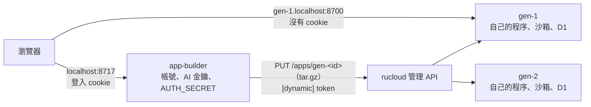

# app-builder — AI 網站產生器（Lovable 式）

輸入一句話，AI 幫你做出一個可部署在 rucloud / Cloudflare 上的靜態網站。具備帳號系統、AI 對話、版本管理；AI 金鑰由使用者自填（或用伺服器環境變數的測試金鑰）。

## 跑起來

```bash
cp examples/app-builder/.dev.vars.example examples/app-builder/.dev.vars   # 填入 AUTH_SECRET（與選填的 AI key）
rucloud serve examples/app-builder/rucloud.toml                            # http://localhost:8717
```

或跟其他範例一起跑：`rucloud serve examples/rucloud.toml`（<http://localhost:8717>）。

產生的每個專案會在執行中新增成 rucloud 的一個獨立應用 `gen-<專案id>`，網址是 <http://gen-1.localhost:8700> 這樣。
這需要 `rucloud.toml` 的 `[edge]`、`[admin]`、`[dynamic]`，所以這個範例要用 `rucloud serve`，不能用 `rucloud dev`。

> 注意：本範例**僅支援 rucloud**。Cloudflare Workers 免費方案每次呼叫只有 10ms CPU，
> 撐不起 AI 長串流的轉發（實測 `exceededCpu`），所以不部署到 Cloudflare。

## 功能

1. **註冊 / 登入** — email + 密碼（PBKDF2 雜湊、HMAC 簽章 cookie，同 myshop 的做法）
2. **兩種專案類型**
   - **靜態網頁**：單一 HTML 檔（內嵌 CSS/JS、localStorage），下載即用
   - **全端應用（Worker + D1）**：AI 產生完整的 rucloud / Cloudflare 專案——`src/worker.js`（D1 API）、`public/index.html`、`schema.sql`（`wrangler.jsonc` 由平台代產），下載 zip 後 `rucloud dev 資料夾 --d1-init DB=schema.sql` 直接跑
3. **AI 設定** — 選供應商（NVIDIA NIM / MiniMax / 自訂 OpenAI 相容端點）、模型、填 API Key（存在 D1，永遠不會回傳給前端）
   - 在 `.dev.vars` 或環境變數提供 `NVIDIA_API_KEY` / `MINIMAX_API_KEY`，就是全站預設金鑰，使用者不必填；沒有時使用者必須自填
4. **專案 + AI 對話** — 像 Lovable：一句話產生第一版；之後持續用對話修改。回應以 **SSE 串流**顯示（含思考過程），完成後自動存成新版本
5. **使用 app** — 右側即時預覽（iframe）、看程式碼（全端模式可切換檔案）；選單切換版本就是部署那個版本上線。每個專案有自己的網址 `http://gen-<專案id>.localhost:8700/`，公開可分享。全端專案是完整執行（自己的 Worker 程序、D1 資料庫）
6. **打包下載** — `⬇ 下載 zip`（或 `GET /api/projects/<id>/download?v=<版本>`）：靜態含 `index.html`；全端含完整專案結構與部署說明

## AI 怎麼產生程式

- **靜態**：系統提示要求模型輸出「單一 HTML 檔」，最後用 `<APP>…</APP>` 標記包住；Worker 抽出後存 D1 的 `versions` 表，`/apps/:id` 直接回傳
- **全端**：系統提示要求用 `<FILE path="...">…</FILE>` 標記輸出多個檔案；Worker 抽出後存 `version_files` 表（`wrangler.jsonc` 與 README 由平台代產，確保格式正確）。zip 解開就是一個標準 wrangler 專案——在 rucloud 與 Cloudflare 上都能跑

## 架構：每個專案是一個獨立的應用



產生的 `src/worker.js` 是使用者（透過 AI）寫的，等於**不可信的程式**，所以不在 app-builder 裡執行。每次產生新版本，app-builder 就把它打包成 tar.gz，用 rucloud 管理 API 的 `PUT /apps/gen-<專案id>` 部署（`rucloud.toml` 的 `[dynamic]`）：

- **自己的程序與沙箱**：讀不到 app-builder 的 `.dev.vars`、資料庫，也讀不到其他專案；`env` 只有自己的 `DB`、`ASSETS`。
- **自己的網域**：`gen-<id>.localhost:8700`，瀏覽器不會把 app-builder 的登入 cookie 送過去，專案之間的 cookie 與 localStorage 也分開。
- **自己的資源上限**：記憶體 128 MB、卡住 5 秒就重開，只影響那個專案。
- **wrangler.jsonc 由平台產生**：AI 輸出的 wrangler 設定會被忽略，產生的程式碼不能自己加綁定；`schema.sql` 變成那個版本的 D1 migration（`migrations/v0003.sql`），新的資料表會在部署時建立。
- **部署用的 token 不在 repo 裡**：rucloud 透過 `[dynamic] grant = ["app-builder"]` 把 `RUCLOUD_ADMIN_URL`、`RUCLOUD_DYNAMIC_TOKEN` 放進 app-builder 的 env；這個 token 只能管理 `gen-` 開頭的應用。管理 API 本身的 token 自動產生在 `.rucloud/admin-token`。

正式環境請把 `APPS_URL`（`wrangler.jsonc` 的 vars）設成另一個可註冊網域，例如 `https://{name}.example-apps.com`，並讓 edge 接到那個網域。

**限制**：沙箱是 Node 的權限模型，不是 VM；產生的程式碼可以對外連線（包括這台機器上其他沒有驗證的服務）。要開放給不認識的人用，請再把 rucloud 放進容器或 VM。

## 檔案

- `src/worker.js` — 帳號、設定、專案 CRUD、SSE 對話（串流轉發 + 版本儲存）、部署到 rucloud（自製 tar.gz）、zip 打包（含自製 ZIP 寫入器）
- `rucloud.toml` — 單獨跑 app-builder 的設定（`[edge]`、`[admin]`、`[dynamic]`）
- `public/index.html` — 單檔 SPA（登入 → 專案列表 → 聊天 + 預覽 + 版本 + 設定）
- `schema.sql` — `users` / `settings` / `projects` / `messages` / `versions` / `version_files`（Worker 啟動時也會冪等地自行建表與補欄位）
- `.dev.vars.example` — 範本；`.dev.vars` 已被 .gitignore 排除，金鑰不進版控

## 安全性

- 密碼 PBKDF2（10 萬次）+ 每人隨機 salt；session 是 HMAC 簽章的 cookie，不洩漏存在性
- API Key 只進 D1，API 回應只給 `hasKey` 與末 4 碼
- 專案與訊息有 user_id 歸屬檢查；產生的 app 則是刻意公開（方便分享成品）
- 產生的程式碼在自己的 rucloud 應用裡執行（見上面的「架構」），碰不到帳號、密碼、金鑰與其他專案
- 會改資料的 API 只接受同一個來源的請求（檢查 `Sec-Fetch-Site` / `Origin`），產生的頁面不能冒用登入身分呼叫
- 預覽的 iframe 加上 `sandbox`（不能把上層頁面導走）
