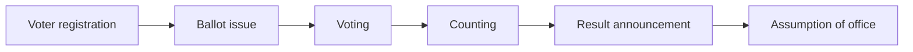

> Filed under: [Law and Politics](#/p/cat-fa) › [Politics](#/p/cat-politics)

## Overview

An **election** is a process of choosing officeholders or settling public questions by voting. It is the principal source of legitimate authority in modern democracies, and also a technical system that must specify who may vote, how districts are drawn and how votes are counted.

## The components of a system

An election has at least four components: the scope of the franchise, the division of districts, candidate eligibility and nomination, and the counting rules. Voting age varies by country and has fallen to 18 in most; Taiwan amended its Constitution in 2019 to lower the age from 20 to 18, with the first application in 2020. The secret ballot is a near-universal requirement, with booths and marking tools designed to reduce pressure and vote trading.

## How seats are allocated

The rule that converts votes into seats shapes the party system. First-past-the-post tends to produce single-party majorities and distorted vote shares, while proportional representation reflects the overall electorate and makes coalition governments more likely; mixed systems split the difference.

| System | Allocation | Main effect |
| --- | --- | --- |
| First-past-the-post | Winner takes the district | Produces majorities, distorts overall vote share |
| Proportional representation | Seats follow vote share | Mirrors the electorate, more coalition cabinets |
| Mixed system | Both rules combined | Balances territorial representation and proportionality |

## Turnout

Turnout is the standard measure of an election's effectiveness. Most democracies fall between 50 % and 70 %, though variation by contest is large: local offices and by-elections can drop below 10 %, while presidential or legislative races often exceed 70 %. In Taiwan's legislative election on 13 January 2024 turnout was about 63 %, with first-time voters aged 18 to 20 well below the average and therefore a focus of party campaigning.

## The electoral sequence

The density of polling stations, the content of official candidate lists and rules on delegated broadcasting all affect the quality of information and the secrecy of the ballot, which is why election commissions are standing agencies in most countries.

## Related articles

- [Political system](#/p/political-system)
- [International relations](#/p/international-relations)
- [Statute](#/p/statute)
- [Precedent](#/p/precedent)
- [Jurisprudence](#/p/jurisprudence)
- [Education policy](#/p/education-policy)
