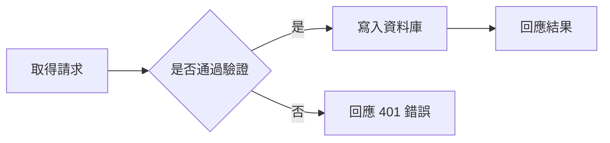

> Filed under: [Engineering and Technology](#/p/cat-gong) › [Information technology](#/p/cat-info-tech)

## Overview

**Mermaid diagrams** are a syntax for describing flowcharts, sequence diagrams, class diagrams and other charts in text, embedded directly in documentation or source comments and rendered automatically into vector graphics. Because the chart lives as text, it can be versioned alongside the code, and users without drawing software can still produce maintainable technical diagrams.

## Origins and rendering paths

Mermaid was developed by the Norwegian programmer Knut Sveim and released in 2014, inspired by the earlier flowchart.js library. It began with flowcharts alone and later added sequence, class, state and Gantt diagrams; current versions cover more than a dozen diagram types. Rendering follows two common paths: mermaid.js produces SVG live in the browser, or a server-side service such as Kroki converts the source to SVG or PNG for embedding in generated documents.

## Diagram types and their keywords

Each diagram type begins with its own keyword, which fixes the semantics of the nodes and the direction of the layout. Mermaid places nodes automatically, but the author still controls their order and grouping, and the resulting complexity depends on restraint.

| Keyword | Diagram type | Main use |
| --- | --- | --- |
| `flowchart TD` | Flowchart | Workflows and decision branches |
| `sequenceDiagram` | Sequence diagram | Messages and ordering between components |
| `classDiagram` | Class diagram | Classes, attributes, methods and relations |
| `stateDiagram-v2` | State diagram | Object states and transition conditions |
| `erDiagram` | Entity relationship diagram | Database schemas and one-to-many relations |
| `gantt` | Gantt chart | Project schedules and milestones |
| `gitGraph` | Git graph | Branching, merging and tagging |
| `journey` | User journey | Experience stages and sentiment scores |

## Authoring conventions and an example

Nodes carry a short identifier with the visible label placed in square brackets, the direction keyword `TD` (top down) or `LR` (left to right) sets the overall flow, and `subgraph` groups related nodes. The example below shows a basic flowchart with a decision branch and can be pasted straight into a `mermaid` code block to render.

## Related articles

- [Software engineering](#/p/software-engineering)
- [Computer network](#/p/computer-network)
- [Web development](#/p/web-development)
- [Markdown syntax](#/p/markdown)
- [Cloudflare Workers](#/p/cloudflare-workers)
- [Machine](#/p/machine)
