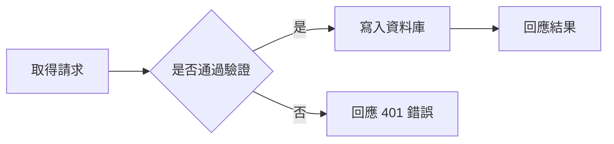

> 分類：[工學門](#/p/cat-gong) › [資訊技術](#/p/cat-info-tech)

## 概述

**Mermaid 圖表**（Mermaid diagrams）是以文字描述流程圖、循序圖、類別圖等圖表結構的語法，可直接內嵌於文件或程式碼註解並自動繪製成向量圖。它讓圖表能隨著程式碼一併進版本控制，也讓沒有繪圖軟體的使用者也能產出可維護的技術圖。

## 起源與渲染方式

Mermaid 由挪威開發者 Knut Sveim 開發，2014 年公開，靈感來自 2003 年的 flowchart.js。早期只支援流程圖，之後逐步加入循序圖、類別圖、狀態圖與甘特圖等，目前版本已涵蓋十多種圖表類型。渲染有兩種常見途徑：在瀏覽器端由 mermaid.js 即時產生 SVG，或在伺服器端透過 Kroki 之類的服務轉換成 SVG 或 PNG，再嵌入產出文件。

## 圖表類型與關鍵字

每一種圖表對應一個開頭關鍵字，決定節點語意與版面方向。Mermaid 會自動排出節點位置，但節點順序與分組仍可由作者控制，而圖表的複雜度則取決於作者是否克制。

| 關鍵字 | 圖表類型 | 主要用途 |
| --- | --- | --- |
| `flowchart TD` | 流程圖 | 作業流程、判斷分支 |
| `sequenceDiagram` | 循序圖 | 系統元件間的訊息往來與順序 |
| `classDiagram` | 類別圖 | 類別、屬性、方法與關聯 |
| `stateDiagram-v2` | 狀態圖 | 物件狀態與轉移條件 |
| `erDiagram` | 實體關聯圖 | 資料庫綱要與一對多關係 |
| `gantt` | 甘特圖 | 專案排程與里程碑 |
| `gitGraph` | 沿革圖 | 版本分支、合併與標籤 |
| `journey` | 使用者旅程圖 | 體驗階段與情緒指數 |

## 撰寫慣例與範例

節點以字母標識、顯示文字另置於方括號中，方向關鍵字 `TD`（上而下）與 `LR`（由左而右）決定整體流向，`subgraph` 用於分組。下列範例示範一個含判斷節點的基本流程圖，可直接貼上 `mermaid` 程式碼區塊渲染。

## 相關條目

- [軟體工程](#/p/software-engineering)
- [電腦網路](#/p/computer-network)
- [網頁開發](#/p/web-development)
- [Markdown 記法](#/p/markdown)
- [Cloudflare Workers](#/p/cloudflare-workers)
- [機械](#/p/machine)
