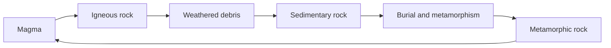

> Filed under: [Earth and Ocean](#/p/cat-di) › [Geology](#/p/cat-geology)

## Overview

A **rock** is an aggregate of minerals forming the solid crust of the Earth. Rocks fall into three great classes — igneous, sedimentary and metamorphic — and each bed of rock preserves a chapter of Earth's four-billion-year history.

## Three classes of rock

Igneous rock forms as magma or lava cools, and it is subdivided into intrusive and extrusive types. Sedimentary rock accumulates from debris, organic remains or chemical precipitate, while metamorphic rock results when existing rock is altered by heat and pressure underground. Measured by volume, igneous rock makes up roughly $95$ % of the crust and sedimentary rock about $5$ %, with metamorphic rock concentrated along plate boundaries.

| Class | Process | Texture | Examples |
| --- | --- | --- | --- |
| Igneous | Magma or lava cools and solidifies | Interlocking crystals, dense | Granite, basalt |
| Sedimentary | Debris, remains or precipitate accumulate | Bedding, often fossil-bearing | Sandstone, limestone |
| Metamorphic | Existing rock altered by heat and pressure | Recrystallised aligned minerals | Marble, gneiss |

## Mineral composition and properties

The four most abundant elements in the crust are oxygen (about $46.6$ %), silicon (about $27.7$ %), aluminium (about $8.1$ %) and iron (about $5.0$ %), bound mainly into quartz, feldspar and mica. Rocks are identified by Mohs hardness (from $1$ to $10$ %), colour, streak, cleavage and grain size; basalt and granite contain about $50$ % and $70$ % silica respectively, and their very different cooling rates give them completely different textures.

## The lithosphere and the rock cycle

Rock together with the mantle beneath it forms the roughly $100$ km thick lithosphere, which is continuously created and recycled by plate tectonics. Weathered debris is transported, deposited, buried, metamorphosed and returned to magma, closing the cycle.

## Related articles

- [Plate tectonics](#/p/plate-tectonics)
- [Geologic history](#/p/geologic-history)
- [Ocean current](#/p/ocean-current)
- [Tide](#/p/tide)
- [Marine ecology](#/p/marine-ecology)
- [Map](#/p/map)
