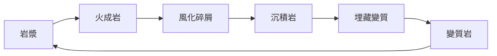

> 分類：[地學門](#/p/cat-di) › [地質](#/p/cat-geology)

## 概述

**岩石**（rock）是由礦物組成、構成地殼的基本物質，分為火成岩、沉積岩與變質岩三大類。岩石不只是地球的骨架，更把四十億年來的地質過程層層記錄下來。

## 三大岩類

火成岩由岩漿冷卻凝固而成，可分為侵入岩與噴出岩；沉積岩由碎屑、生物遺骸或化學沉澱層積而成；變質岩則是原有岩石在地下受高溫高壓改造的產物。以體積計，火成岩約佔地殼的 $95$ %，沉積岩約 $5$ %，變質岩則多分布於板塊交界的地帶。

| 岩類 | 形成作用 | 結構特徵 | 常見例子 |
| --- | --- | --- | --- |
| 火成岩 | 岩漿或熔岩冷卻凝固 | 晶粒互相嵌鎖、緻密 | 花崗岩、玄武岩 |
| 沉積岩 | 碎屑、遺骸或化學沉澱層積 | 具層理，常含化石 | 砂岩、石灰岩 |
| 變質岩 | 高溫高壓下原岩改造 | 礦物重新定向排列 | 大理岩、片麻岩 |

## 礦物組成與性質

地殼中含量最高的元素是氧（約 $46.6$ %）、矽（約 $27.7$ %）、鋁（約 $8.1$ %）與鐵（約 $5.0$ %），主要礦物為石英、長石與雲母。辨識岩石可依據莫氏硬度刻度（$1$ 到 $10$）、顏色、條痕、解理與晶粒構造，玄武岩與花崗岩的 SiO₂ 含量分別約 $50$ % 與 $70$ %，冷卻速率不同更讓兩者的結構迥異。

## 岩石圈與岩石循環

岩石與上覆地幔岩石共同構成厚約 $100$ 公里的岩石圈，在板塊構造作用下不斷新生與回收。風化產物被搬運、沉積，再經埋藏變質返回岩漿，形成循環。

## 相關條目

- [板塊構造](#/p/plate-tectonics)
- [地史](#/p/geologic-history)
- [洋流](#/p/ocean-current)
- [潮汐](#/p/tide)
- [海洋生態](#/p/marine-ecology)
- [地圖](#/p/map)
