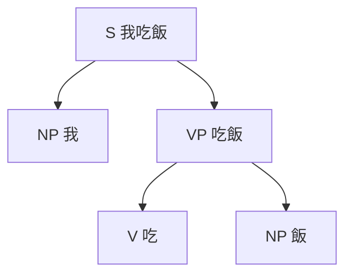

> Filed under: [Humanities and Languages](#/p/cat-wen) › [Languages](#/p/cat-languages)

## Overview

**Syntax** studies how words combine into grammatical phrases and sentences and how those structures convey meaning. It treats language as a system of decomposable constituents and is the most formal part of linguistics.

## Units of analysis

Syntactic analysis deals with three kinds of unit: phrases, constituents, and dependency relations. A span of text that can be removed from a sentence while leaving a well-formed clause is a constituent, while dependency grammar treats the sentence as a tree of heads and dependents. Corpus annotation labels constituents with symbols such as $NP$ for noun phrase and $VP$ for verb phrase, and the Penn Treebank defines $45$ tags in all.

## Basic word order

Word order is the most visible difference in grammar and the first threshold learners notice. In a few languages such as Russian and Finnish order is relatively free and roles are marked by case endings; most languages fix order instead. Order is not mere custom: it constrains which constituents can occupy focus position and shapes pronoun distribution, so it ties directly to discourse structure.

| Language | Basic order | Example |
| --- | --- | --- |
| Mandarin | Subject–Verb–Object (SVO) | 我吃飯 |
| English | Subject–Verb–Object (SVO) | I eat rice |
| Japanese | Subject–Object–Verb (SOV) | ご飯を食べる |
| Turkish | Subject–Object–Verb (SOV) | Kitabı okudum |
| Irish | Verb–Subject–Object (VSO) | Bhí sé in ann |
| German | Verb second (V2) | Heute gehe ich nach Hause |

## Theory and formalization

The mainstream framework was set by Chomsky’s Syntactic Structures of $1957$, arguing that linguistic competence generates an infinite set of sentences from finite means, and was later revised through surface structure, deep structure, and the Minimalist Program. Formal grammars describe sentences as strings arranged in trees, can be written as context-free grammars, and decide whether a given string belongs to the language.

## Related articles

- [Phonology](#/p/phonology)
- [Linguistics](#/p/linguistics)
- [Poetry](#/p/poetry)
- [Novel](#/p/novel)
- [Drama](#/p/drama)
- [Periodization](#/p/periodization)
