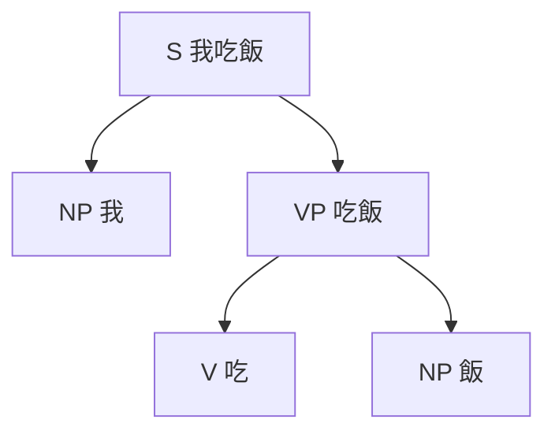

> 分類：[文學門](#/p/cat-wen) › [語言](#/p/cat-languages)

## 概述

**句法**（syntax）研究詞與詞如何組成合乎語法的短語與句子，以及這些結構如何傳遞意義。它把語言視為可分解的成分層次，也是語言學中形式化程度最高的部分。

## 分析單位

句法分析關注三類單位：詞組、成分與依存關係。句子中若抽去某段連續文字後仍構成合法子句，該段就是成分；依存句法則把句子視為由「支配」與「從屬」連結的樹狀結構。語料庫標註常以 $NP$（名詞短語）、$VP$（動詞短語）等符號標記成分類別，Penn Treebank 共定義 $45$ 種標籤。

## 基本詞序

詞序是語法中最容易觀察到的差異，也是學習者最先意識到的門檻。少數語言（如俄語、芬蘭語）詞序相對自由，角色由格的變化標示；多數語言則以固定詞序承擔這些功能。詞序並非純粹的習慣，它限制哪些成分可以出現在焦點位置，也影響代詞的分布，因此與篇章結構直接相關。

| 語言 | 基本詞序 | 例句 |
| --- | --- | --- |
| 漢語 | 主—動—賓（SVO） | 我吃飯 |
| 英語 | 主—動—賓（SVO） | I eat rice |
| 日語 | 主—賓—動（SOV） | ご飯を食べる |
| 土耳其語 | 主—賓—動（SOV） | Kitabı okudum |
| 愛爾蘭語 | 動—主—賓（VSO） | Bhí sé in ann |
| 德語 | 動詞第二位（V2） | Heute gehe ich nach Hause |

## 理論與形式化

現代句法學的主流框架由喬姆斯基於 $1957$ 年的《句法結構》奠定，主張語言能力由一套有限手段生成無限句子，此後歷經表層結構、深層結構與最簡方案等修正。形式語言把句子描述成樹狀符號串，可用文脈無關文法表示，並能判定某個字串是否屬於該語言。

## 相關條目

- [音韻](#/p/phonology)
- [語言學](#/p/linguistics)
- [詩](#/p/poetry)
- [小說](#/p/novel)
- [戲劇](#/p/drama)
- [斷代史](#/p/periodization)
